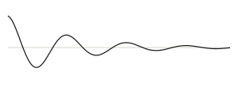

[This page exercises]{.newthought} every typographic element the site uses, so the brand can be checked in one place. The opening words of a section are set in small capitals in Tufte red, as in Tufte's books. The rest of this paragraph is ordinary body text at the intended measure, long enough to judge line length, word spacing and leading across several lines of running prose.^[Footnotes become sidenotes in the right margin on wide screens and flow inline on narrow ones.]

## A second-level heading in italic

[Statistical machine learning]{.newthought} sits between statistics and computer science. A paragraph may contain a [link to Tufte CSS](https://edwardtufte.github.io/tufte-css/), *emphasis in italic*, **rare bold**, inline code such as `quarto render`, and inline maths such as $p(\theta \mid x) \propto p(x \mid \theta)\,p(\theta)$. Old-style figures appear in running text: 1984, 2026, 37.5 per cent.^[A second sidenote, with a [link inside it](https://quarto.org) and some maths, $\mathbb{E}[X] = \mu$.]

::: {.column-margin}
{fig-alt="A thin black line oscillating about a horizontal grey axis, with amplitude decaying from left to right."}
:::

Display maths should inherit the text colour:

$$
\hat{\beta} = \arg\min_{\beta} \; \frac{1}{2n} \lVert y - X\beta \rVert_2^2 + \lambda \lVert \beta \rVert_1 .
$$

### A third-level heading

> Above all else show the data.
>
> --- Edward Tufte, *The Visual Display of Quantitative Information*

A bulleted list:

- First item, short.
- Second item, long enough to wrap onto a second line so that the hanging indent and the line spacing within list items can be checked.
- Third item.

A numbered list:

1. Specify the model.
2. Fit it.
3. Criticise it.

A code block:

```r
fit <- glm(y ~ x, family = binomial(), data = df)
summary(fit)
```

A table:

| Method       | Parameters | Error |
|:-------------|-----------:|------:|
| Lasso        |         12 | 0.184 |
| Ridge        |        200 | 0.201 |
| Elastic net  |         31 | 0.179 |

: A small table with booktabs-style rules.

---

A paragraph after a thin rule, to close the page.
